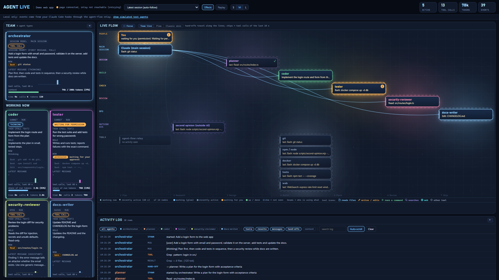
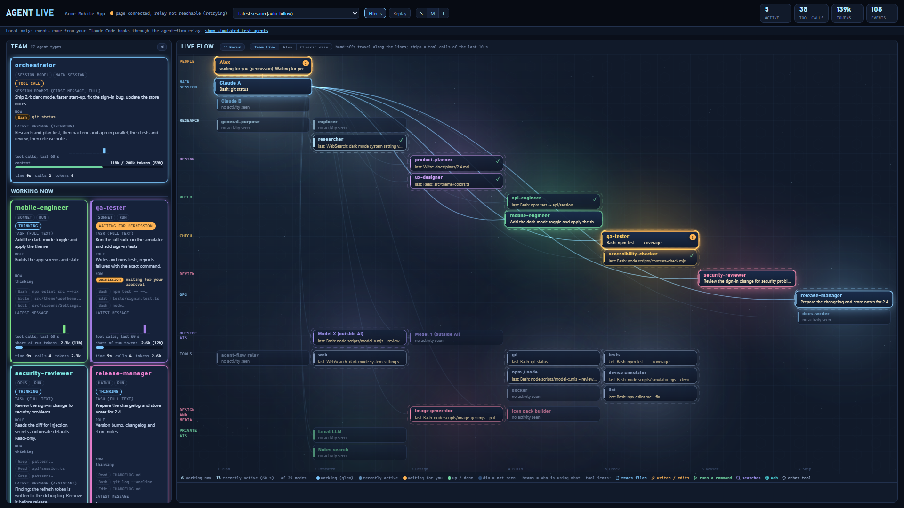
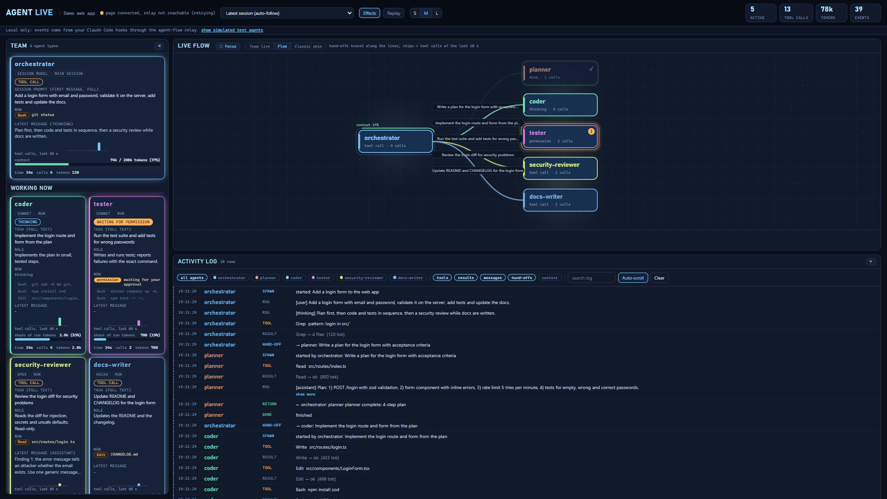

# Agent Live Kit

**A live map of your Claude Code agent team.** See who is working right now, what each agent is doing, how work is handed from one agent to the next, and a log of everything that happened, on one local web page.



*(The picture is the built-in demo: a made-up web-app team. `agent-live simulate` shows it on your machine in one command.)*



*(`agent-live simulate --team large`: a bigger made-up team. Flow and Classic views of the same session: [flow](docs/img/large-flow.png), [classic](docs/img/large-classic.png).)*

## The problem it solves

When you run Claude Code with sub-agents, the terminal shows one long scroll of text. You cannot tell at a glance:

- which sub-agents are running **right now**, and what each one is doing,
- who handed work to whom,
- whether something is stuck **waiting for your permission**,
- what happened ten minutes ago (the scroll moved on).

Agent Live Kit turns that stream into a picture you can keep on a second monitor. It is **local only** (nothing leaves your computer), has **no dependencies** (just Node.js), and works for **any project**: you describe your team in one small file, or let `agent-live init` write it for you.

## Install

You need [Node.js](https://nodejs.org) 20 or newer and Claude Code. Works on Windows, macOS and Linux.

### Option 1: let Claude install it (easiest)

Open Claude Code in the project you want to watch and paste this (replace `https://github.com/rcarrascom/agent-live-kit.git` with this repository's address):

> Install Agent Live Kit from `https://github.com/rcarrascom/agent-live-kit.git`: clone it next to my project (not inside it), then in my project folder run `node <clone>/bin/agent-live.mjs init`, then `doctor` and fix anything it flags, then `start --open`. Tell me when to open a new Claude Code session.

Claude does the steps below for you. The one thing it cannot do is restart itself: open a **new** Claude Code session afterwards, because hooks are read when a session starts.

### Option 1b: one skill, then say "install agent live"

Copy the skill once and Claude knows how to install, repair and start the kit by itself, in any project:

```bash
mkdir -p ~/.claude/skills/agent-live
git clone https://github.com/rcarrascom/agent-live-kit.git /tmp/alk && cp /tmp/alk/skill/agent-live/SKILL.md ~/.claude/skills/agent-live/
```

Then open Claude Code in your project and type `/agent-live` (or "install agent live"). It asks once before touching your Claude settings.

### Option 2: manual

```bash
git clone https://github.com/rcarrascom/agent-live-kit.git ~/agent-live-kit             # once, anywhere outside your project
cd your-project                                   # the folder where you run Claude Code
node ~/agent-live-kit/bin/agent-live.mjs init     # 1. scans your project, writes agent-live.config.json
node ~/agent-live-kit/bin/agent-live.mjs doctor   # 2. checks everything and tells you how to fix what is missing
node ~/agent-live-kit/bin/agent-live.mjs start --open   # 3. starts the relay and the page, opens your browser
```

Optional: `cd ~/agent-live-kit && npm link` once, then type `agent-live init`, `agent-live doctor`, `agent-live start --open` anywhere.

Just want to look first? `node ~/agent-live-kit/bin/agent-live.mjs simulate` opens a demo with a fake team. No agents, no setup.

Then use Claude Code as usual **in a new session** (hooks are read when a session starts). Agents appear on the map as they work.

## What you will see

| Where | What it shows |
|---|---|
| **Team live** (default tab) | Your whole team as a map: people, the main session, every agent type, outside AIs, tools. Idle nodes are dim, working ones glow, **amber with "!" means it is waiting for you**. Beams travel from an agent to the tool it used. Each box says what it is doing now and has a 60-second activity sparkline. Click a box for its recent history. |
| **Flow** tab | The main session with its sub-agents, hand-offs drawn as travelling packets, tool calls as small chips. |
| **Classic** tab | The same data as glowing hexagons, one per run, kept after they finish (5 min, 30 min or the whole session). |
| **Focus** (key `F`) | The map fills the window. `Esc` returns. |
| **Team panel** (left) | One card per agent: its task in full, its role, the tool it is running, the latest message, tokens, time. Key `T` hides it. |
| **Activity log** (bottom) | Every event, never cleared unless you press Clear. Filter by agent or kind, search, click a row for the full text. Key `L` hides it. |
| Top bar | Session picker (default: follows the newest session), **Effects** on/off, **Replay** (scrub back through a session), **S / M / L** size, counters. |



## How it works (one picture)

```
 Claude Code session                      your machine only
 ┌──────────────────┐   hooks    ┌────────────────┐  events   ┌─────────────────────┐  page   ┌─────────┐
 │ main session +   │ ─────────► │ agent-flow     │ ────────► │ agent-live server   │ ──────► │ browser │
 │ sub-agents       │ (each tool │ relay (:3001)  │  (SSE)    │  ring buffer + JSONL│  (:3002)│  (UI)   │
 └──────────────────┘  call)     └────────────────┘           │  agent types from   │         └─────────┘
          │                                                    │  meta.json files    │
          └─ writes subagents/*.meta.json ───────────────────► │  team map + rules   │
                                                               └─────────────────────┘
```

1. Claude Code runs **hooks** (small commands) on every tool call and every sub-agent start or stop.
2. The open-source [agent-flow](https://github.com/patoles/agent-flow) relay receives those hook calls and streams them out.
3. The Agent Live server reads that stream, remembers the last 2000 events (and saves all of them to a file), works out *which* agent type each run is, and serves the page.
4. The page turns events into the map, the cards and the log.

More detail: [docs/HOW_IT_WORKS.md](docs/HOW_IT_WORKS.md).

## The commands

| Command | What it does |
|---|---|
| `agent-live init` | Reads `.claude/agents/*.md`, guesses a band (research, design, build, check, review, ops, outside) for each agent, detects your tools (git, npm, pip, cargo, go, make, docker, CI...), writes `agent-live.config.json` and **explains each choice**. `--dry-run` previews, `--force` overwrites. |
| `agent-live doctor` | **The check tool.** Green / yellow / red lines for Node version, config validity, agent files, Claude's session folder, hooks, relay, ports, history file, a test event round trip, orphan nodes, rule syntax. Each problem comes with a concrete fix. Exit code 1 if anything is red. `--json` for scripts. |
| `agent-live start` | Starts the relay if it is not running (telemetry off) and the page. Prints the address. It never kills anything. `--open`, `--no-relay`, `--port N`. |
| `agent-live simulate` | A demo team with scripted events. `--team large` shows a busy team of about 30 boxes. `--instant`, `--loop`, `--port N`, or `--inject URL` to send the events to a page that is already running. |
| `agent-live open` | Opens the page in your browser. |
| `agent-live hooks` | Shows (or, with `--install --config-dir DIR`, merges) the Claude Code hooks. |

## FAQ

**Is anything sent to the internet?** No. The page, the server and the history file are local. The relay is started with telemetry switched off (`AGENT_FLOW_TELEMETRY=false`). The first run downloads the relay package from npm, like any `npx` command.

**Do I need to change my agents?** No. It reads the same `.claude/agents/*.md` files Claude Code already uses.

**I use several Claude accounts or git worktrees.** Supported: list the extra folders in `claude.extraProjectPaths` and label accounts with `accounts` (see [docs/CONFIG.md](docs/CONFIG.md)). Hooks must be installed in each Claude config folder; `agent-live doctor` checks each one.

**Why does an agent show as "unmatched" or "sub-agent"?** The page needs Claude Code's `meta.json` file to learn which agent type a run belongs to. See [docs/TROUBLESHOOTING.md](docs/TROUBLESHOOTING.md).

**Where is the history stored?** `.agent-live/events.jsonl` in your project (add `.agent-live/` to your `.gitignore`: it can contain command lines and messages). Keep size down with `history.maxLines`.

**Can I add my own tools or outside AIs to the map?** Yes: add a node, then an activity rule such as "when a shell command contains `ollama`, light the Ollama node". Examples in [docs/CONFIG.md](docs/CONFIG.md).

## Honest limits

- **It only knows what Claude Code's events show.** A tool, script or AI that Claude Code never calls from a command stays dim ("no activity seen"). Outside AIs are only lit when a command or MCP tool name mentions them (you write that rule). Nothing is faked.
- **No cost figures.** The stream has no prices; tokens are estimates from tool results plus context size.
- **It collects from the moment it runs.** Runs that started before the relay did have no type.
- **Local, single-user.** There is no login and no sharing. It listens on `127.0.0.1` only and refuses requests with a foreign `Host` or `Origin`, so other web pages cannot read it or feed it events. Do not expose the port with a tunnel or proxy: the history can contain command lines and messages.
- **Tested on Windows.** The code uses only Node's built-in modules and no shell-specific parts, but macOS and Linux were not run by the author. Please report problems.
- **The relay is a third-party package** (agent-flow, Apache-2.0), pinned to a version. See [NOTICE](NOTICE).

## More

- [docs/CONFIG.md](docs/CONFIG.md) - every config field with examples
- [docs/HOW_IT_WORKS.md](docs/HOW_IT_WORKS.md) - architecture
- [docs/TROUBLESHOOTING.md](docs/TROUBLESHOOTING.md) - driven by the doctor's messages
- [docs/HOWTO_RUN_AN_AI_AGENT_TEAM.md](docs/HOWTO_RUN_AN_AI_AGENT_TEAM.md) - how to run a team of agents on any project (accounts, lanes, critic, hooks, check script, retros)
- [recipes/](recipes/) - agent file templates, guard / session-start / spawn-log hooks, a CLAUDE.md template, a retro template

## Licence

MIT for this kit's code (see [LICENSE](LICENSE)). It reads the event stream of agent-flow (Apache-2.0) and re-implements visual techniques studied from it; credit in [NOTICE](NOTICE).
